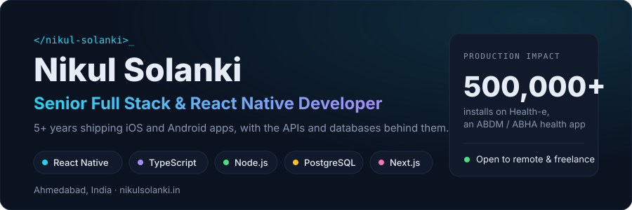
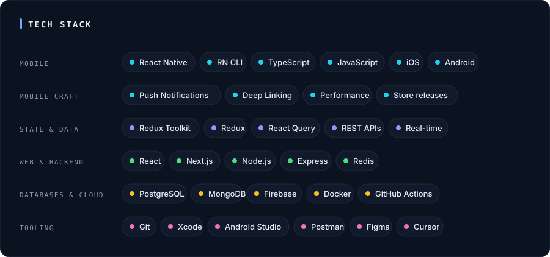
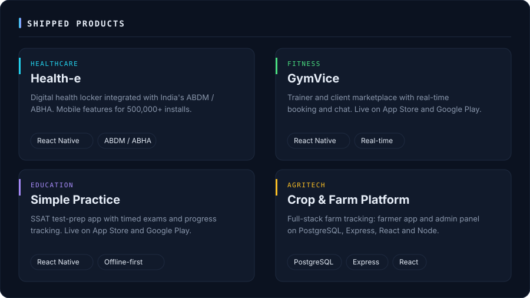

  
  
  
  

## About

I build mobile apps end to end: **React Native** clients for iOS and Android, and the **Node.js / Express** APIs, **PostgreSQL / MongoDB** databases and **Firebase** services behind them. I have 5+ years in production, mostly in healthcare, fitness and education, and I also build web products and admin dashboards with **React** and **Next.js**.

- **Mobile architecture:** Redux Toolkit state, REST API integration, real-time features, push notifications, deep linking
- **Production work:** performance optimization, app store releases, debugging live apps
- **Healthcare:** features for **Health-e**, a digital health locker integrated with India's ABDM / ABHA, with 500,000+ installs
- **AI-assisted workflow:** I use Cursor to move faster without cutting corners

Based in Ahmedabad, India. I speak Gujarati, Hindi and English.

## Tech stack

## Shipped products

Most of my professional work is closed source and owned by the client or employer. More detail on my <a href="https://nikulsolanki.in">portfolio</a>.

## Open source

## GitHub activity

## Contact

Looking for a senior React Native or full-stack engineer? I'm open to remote and freelance work.

| | |
|---|---|
| Portfolio | [nikulsolanki.in](https://nikulsolanki.in) |
| LinkedIn | [Nikul Solanki](https://www.linkedin.com/in/solankinikul/) |
| Email | [nikulsolanki707@gmail.com](mailto:nikulsolanki707@gmail.com) |
| Stack Overflow | [solanki-nikul](https://stackoverflow.com/users/20278666/solanki-nikul) |

Plain-text summary

**Nikul Solanki, Senior Full Stack & React Native Developer** (Ahmedabad, India). 5+ years building production iOS and Android apps with React Native and TypeScript, plus Node.js / Express APIs on PostgreSQL and MongoDB. Shipped Health-e (ABDM / ABHA health app, 500,000+ installs), GymVice (fitness marketplace) and Simple Practice (SSAT test prep), and built a full-stack crop and farm tracking platform. Also works with React, Next.js, Firebase, Redis and Docker.

